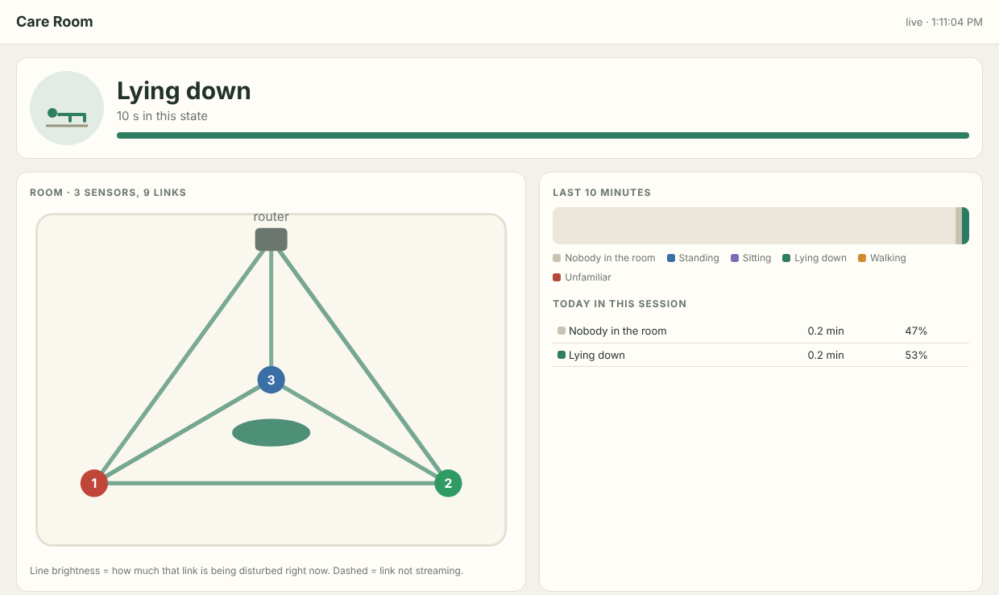
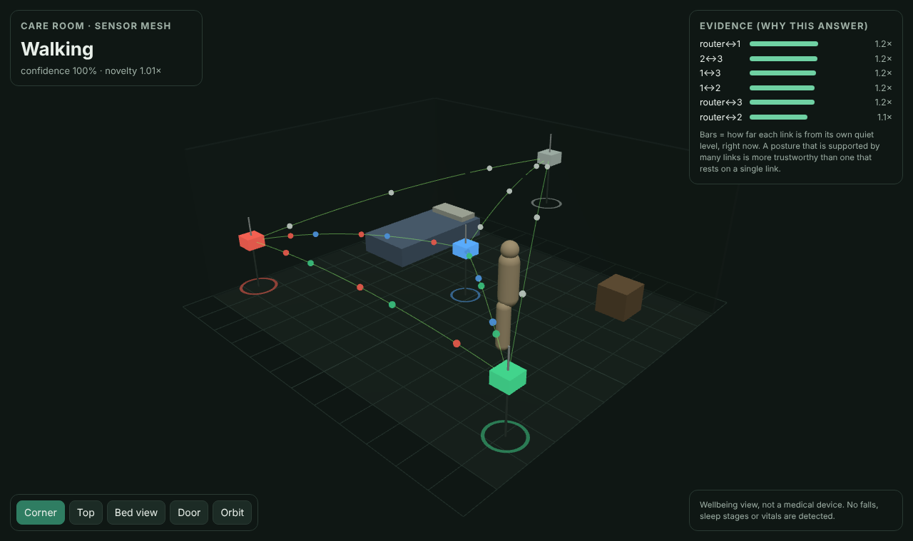

<div align="center">

# 🏠 Care Room

### Privacy-first elderly-care monitoring with a 3-board Wi-Fi sensing mesh

**No camera in daily use.** Three ESP32-S3 boards and a router feel the room through Wi-Fi signals, and a caretaker sees in plain words what is happening.

    

</div>

---

## ✨ What it does

| | |
|---|---|
| 🧍 **Knows what the person is doing** | nobody · standing · sitting · **lying down** · walking, from Wi-Fi signals alone |
| 🛰️ **9-link mesh** | every board talks to every other board *and* the router, so the room is seen from many directions, not only from the router |
| 🤷 **Says "I don't know"** | if furniture or a board is moved, it shows **"unfamiliar"** instead of guessing |
| ⚖️ **A statistical judge** | 10 numpy-only models check whether the sensors can be trusted, what kind of fault it looks like, and whether the person's daily routine is usual |
| 🎓 **Camera as a teacher** | a fixed webcam labels postures **only while teaching**; afterwards it is switched off. No video is ever stored |
| 🗄️ **Everything stays local** | training lives in one file on your PC (`data/movement.npz`). Nothing goes to a cloud |

> Wellbeing view only. **Not a medical device**: no fall, sleep-stage or vital-sign detection.

## 🧠 How it works

```
 3 × ESP32-S3 + router ──UDP──▶ PC server ──▶ per-link features ──▶ kNN + novelty check ──▶ posture / "unfamiliar"
        (9 Wi-Fi links)         (kit/server.py)   (156 numbers/link)      (k = 7)                 │
                                                                                                  ▼
 Teaching only:  webcam ──▶ posture label ──▶ data/movement.npz        Caretaker page · 3D mesh · Judge lab
 Judge (T1–T10): is the sensing healthy? is the routine usual?  ─────────────────────────────────────┘
```

**Teach once, then the camera goes away.** A pose model in the browser reads the body, the posture word becomes the label for the Wi-Fi measured at the same moment, and after 3 training rounds plus 1 test round the model needs only Wi-Fi.

## 🧩 What we added

| Area | Ours |
|---|---|
| Recognition | **lying** class, **unfamiliar-room** detection (novelty score), stale-data counter |
| Teaching | fixed-view **teacher camera**: view lock, guided recording, camera-vs-instruction report |
| Judge | 10 statistical models T1–T10 + isolation forest: trust score, change points, local vs room-wide, fault cause, daily routine, unexpected stillness, activity HMM |
| Interfaces | plain-language **caretaker page**, **3D sensor mesh** (packets on all 9 links), judge lab, ML-models map |
| Testing | software board simulator + scripted teacher, so the chain runs without the boards |
| Future | **Arduino UNO Q** supervisor, **STM32F407VET6** proof of concept |

Full comparison: [`docs/ENHANCEMENTS.md`](docs/ENHANCEMENTS.md) · Design notes: [`docs/DESIGN_NOTES_unfamiliar_and_rag.md`](docs/DESIGN_NOTES_unfamiliar_and_rag.md)

## 🗂️ Repository map

```
kit/            sensing pipeline: server, evaluation, base dashboards
firmware/       board firmware build / flash tools
care/web/       caretaker page · 3D mesh · teacher camera · hub
care/sim/       board simulator, scripted teacher, evaluation driver
care/tests/     pose-rule tests          care/results/  raw results
docs/           enhancements, design notes, future/ (UNO Q plan and gaps)
uno_q_system/   Arduino UNO Q supervisor (planned)
stm32_poc/      STM32F407VET6 proof of concept
third_party/    licences and notices
```

## 🚀 Quick start

Step-by-step with every command: **[SETUP.md](SETUP.md)**. The short version (Ubuntu / WSL2):

```bash
python3 -m venv .venv && source .venv/bin/activate
pip install numpy pyyaml
cp config.example.yaml config.yaml        # router address, 3 board MACs, PC address
python install.py                         # packages + pose model (once)
python firmware/build.py && python firmware/flash.py     # boards
python kit/server.py                      # then open http://127.0.0.1:8932/care/
```

No boards at hand? Try the simulator:
```bash
KIT_SOURCE=SYNTHETIC python kit/server.py      # terminal 1
python care/sim/kit_sim.py                     # terminal 2
```

| Page | URL |
|---|---|
| Hub | `/care/` |
| Caretaker view | `/care/care.html` |
| 3D sensor mesh | `/care/nodes3d.html` |
| Teacher camera | `/care/care_teacher.html` |

Hardware list: [HARDWARE_REQUIREMENTS.md](HARDWARE_REQUIREMENTS.md)

<!-- Add your own screenshots to docs/images/ and uncomment:



-->

## 🛣️ Roadmap

- [x] 3-board mesh sensing and teaching with the camera
- [x] Unfamiliar-room check, lying class, caretaker page, 3D mesh
- [x] Judge T1–T10 with 34 automated tests
- [x] STM32F407VET6 proof of concept (statistical models on a microcontroller)
- [ ] Run the judge on the 9-link mesh features
- [ ] Multi-day recordings with more people and rooms; false alarms per day
- [ ] **Arduino UNO Q supervisor**: versioned room baselines, change detection, caretaker-confirmed recalibration → [plan](docs/future/ARDUINO_UNO_Q_PLAN.md), [open questions](docs/future/UNO_Q_GAPS_TO_FILL.md)

## 🔒 Privacy and safety

- The camera is used only while teaching; video stays in the browser and is never saved or sent.
- Only numbers are stored (Wi-Fi features and a posture word), locally.
- Anyone who may appear on camera during teaching should know about it.
- The system reports observations ("unusual for this person at this time"), never diagnoses.

## 🙏 Credits

Built on the open-source **wifi-sensing-kit** and **RuView** `esp32-csi-node` firmware v0.8.8 (MIT), with **MediaPipe Pose** (Apache-2.0) and **three.js** (MIT). Their licences and notices are in [`third_party/`](third_party/).

## 👤 Author

**Deva Kumar G**
