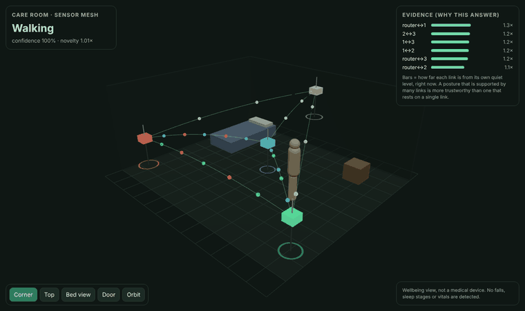
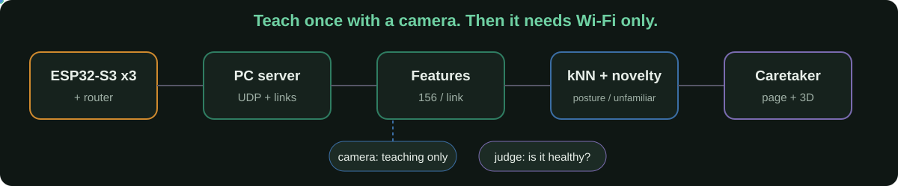
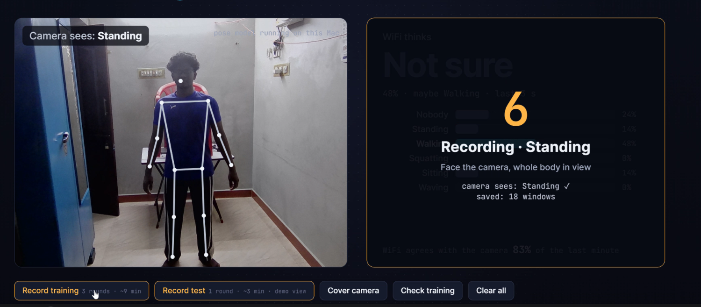
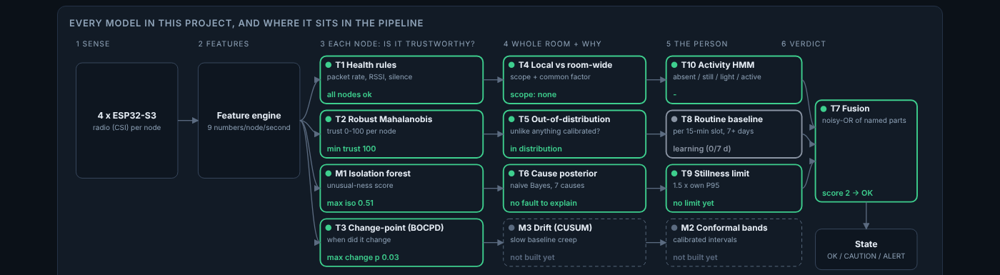
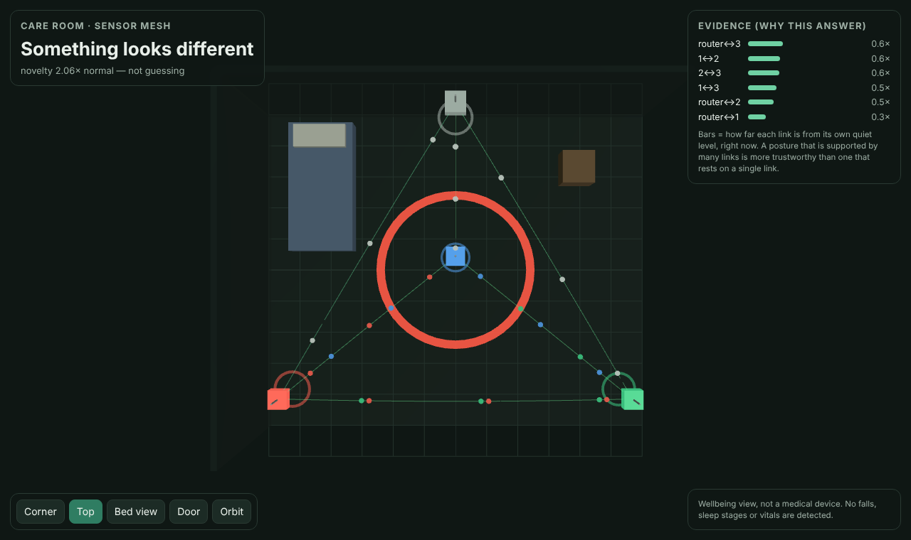
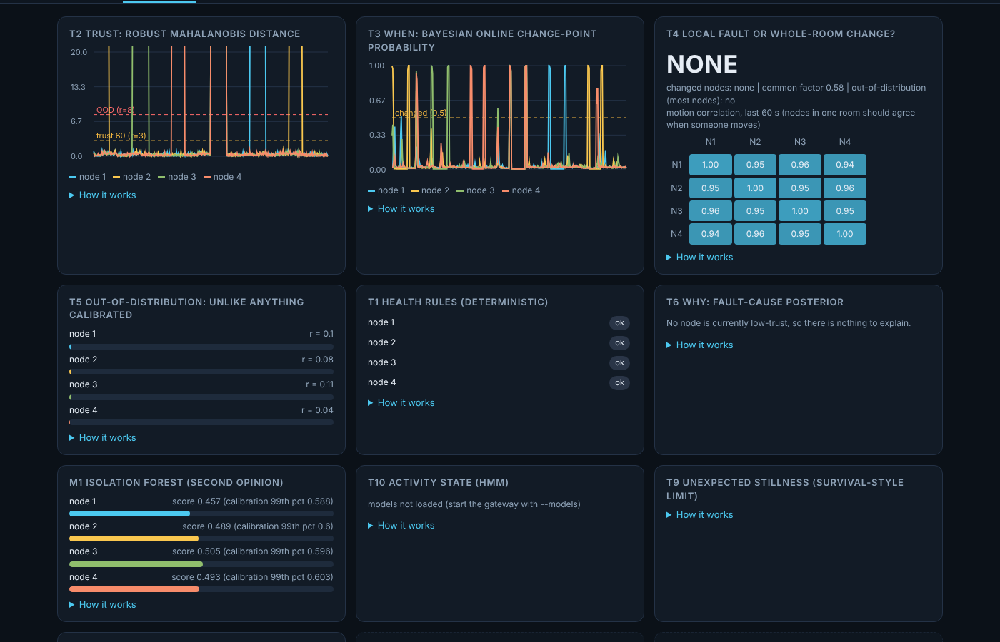

<div align="center">



<br/>


**Three small boards and a router feel the room through Wi-Fi.<br/>A caretaker sees in plain words what is happening, and nobody is on camera.**

[Quick start](#-quick-start) · [How it works](#-how-it-works) · [The judge](#%EF%B8%8F-the-judge) · [Interfaces](#-interfaces) · [Roadmap](#%EF%B8%8F-roadmap) · [Setup guide](SETUP.md)

</div>

---

## ✨ Why Care Room?

Cameras are unwelcome in bedrooms and bathrooms. Wearables get forgotten. But **Wi-Fi is already in the room**, and a human body changes the signal that travels between two devices. Care Room reads that change.

| | |
|---|---|
| 🧍 **Knows the posture** | nobody · standing · sitting · **lying down** · walking, from Wi-Fi alone |
| 🕸️ **9-link mesh** | every board talks to every other board *and* the router, so the room is seen from many directions instead of from one corner |
| 🤷 **Says "I don't know"** | when furniture or a board has moved it shows **"unfamiliar"** instead of guessing |
| ⚖️ **A statistical judge** | 10 numpy-only models check whether the sensors can be trusted, what kind of fault it looks like, and whether the daily routine is usual |
| 🎓 **Camera as a teacher** | a fixed webcam labels postures **only while teaching**, then it is switched off. No video is ever stored |
| 🗄️ **Everything local** | training lives in one file on your PC. Nothing goes to a cloud |

> ⚠️ Wellbeing view only. **Not a medical device**: no fall, sleep-stage or vital-sign detection.

<div align="center">

<br/><sub>3D sensor mesh: packets travel on every link; a person walks through the room. Interface preview.</sub>
</div>

## 🧠 How it works

<div align="center">

</div>

1. **Sense.** 3 × ESP32-S3 measure Wi-Fi channel state (CSI) from the router *and* from each other: **9 directed links**.
2. **Understand.** Each link becomes 156 numbers every half second. A k-nearest-neighbour model (k = 7) compares them with labelled examples it has stored.
3. **Be honest.** A novelty score checks that the live signal looks like something already learned. If not, the answer is **"unfamiliar"**.
4. **Show.** A caretaker page and a 3D mesh view display the result, and which links support it.

### 🎓 Teach once, then the camera goes away

| | Teaching (a few minutes, once) | Daily use |
|---|---|---|
| 📷 Camera | **ON**, fixed in the room | **OFF** |
| 📡 Wi-Fi | recorded | the **only** input |
| 🧾 What is saved | Wi-Fi numbers + a posture word | nothing new |
| 🎥 Video | processed in the browser, never saved | none exists |

<div align="center">

<br/><sub>A real teaching session: the camera labels the posture (left) while Wi-Fi windows are saved (right).</sub>
</div>

## 🕸️ Why a 9-link mesh?

A router-only set-up sees the room from **one point**: 3 links. With every board also transmitting, there are **9 directed links** crossing the room from different sides.

| | Router only | Care Room mesh |
|---|---|---|
| Links | 3 | **9** (6 sender-receiver pairs) |
| Views of the room | from the router's side | from many directions |
| Cross-checking | none | both directions of a pair should agree |
| A moved board | hard to localise | only its links change |

## ⚖️ The judge

A set of **ten statistical models** that watch *how the sensors behave* and *how the person's day looks*, written in plain numpy with JSON model files so they can run on a PC or a microcontroller.

| ID | Model | In one line |
|---|---|---|
| T1 | Health rules | offline, packet loss, stuck or jumping signal |
| T2 | Robust Mahalanobis trust | 0–100 trust per node against its own healthy baseline |
| T3 | Bayesian change-point | did the behaviour just change? |
| T4 | Local or room-wide | one node, some, or the whole room |
| T5 | Out-of-distribution | "unlike anything calibrated" → UNKNOWN, never a false OK |
| T6 | Fault-cause posterior | dropout, stuck, moved, noisy… as a ranked hint |
| M1 | Isolation forest | a second opinion on unusualness |
| T7 | Fusion | one OK / CAUTION / ALERT state |
| T8 | Daily routine | what is usual for *this* person in each 15-minute slot |
| T9 | Unexpected stillness | daytime stillness longer than their own history |
| T10 | Activity HMM | absent · still · light · active |

A machine fault is **capped at CAUTION**: a broken sensor never claims the person is unwell.

<div align="center">

<br/><sub>Every model and where it sits in the pipeline. Interface preview.</sub>
</div>

## 🖥️ Interfaces

<table>
<tr>
<td width="50%"><br/><sub><b>Caretaker page</b>: posture, confidence, the 9 links, a 10-minute timeline, gentle notices.</sub></td>
<td width="50%"><br/><sub><b>Unfamiliar room</b>: the mesh view after furniture is moved. It refuses to guess.</sub></td>
</tr>
</table>

<details>
<summary><b>Judge lab</b> (for engineers)</summary>
<br/>

<br/><sub>Each model live, with a plain-language explanation. Interface preview from the earlier 4-node stack.</sub>
</details>

## 🧩 What we added

| Area | Ours |
|---|---|
| Recognition | **lying** class, **unfamiliar-room** detection, stale-data counter |
| Teaching | fixed-view teacher camera: view lock, guided recording, camera-vs-instruction report |
| Judge | models T1–T10 + isolation forest with explainable fault cause |
| Interfaces | caretaker page, 3D sensor mesh, judge lab, ML-models map |
| Testing | software board simulator and scripted teacher, plus 34 automated tests |
| Future | **Arduino UNO Q** supervisor · **STM32F407VET6** proof of concept |

Full comparison with the base project: [`docs/ENHANCEMENTS.md`](docs/ENHANCEMENTS.md)

## 🚀 Quick start

> Full step-by-step guide with every command: **[SETUP.md](SETUP.md)**

```bash
python3 -m venv .venv && source .venv/bin/activate
pip install numpy pyyaml
cp config.example.yaml config.yaml          # router address, 3 board MACs, PC address
python install.py                           # packages + pose model (once)
python firmware/build.py && python firmware/flash.py     # the boards
python kit/server.py                        # then open http://127.0.0.1:8932/care/
```

| Page | URL |
|---|---|
| Hub | `/care/` |
| Caretaker view | `/care/care.html` |
| 3D sensor mesh | `/care/nodes3d.html` |
| Teacher camera | `/care/care_teacher.html` |

Parts list: [HARDWARE_REQUIREMENTS.md](HARDWARE_REQUIREMENTS.md)

## 🗂️ Repository map

```
kit/            sensing pipeline: server, evaluation, base dashboards
firmware/       board firmware build and flash tools
care/web/       caretaker page · 3D mesh · teacher camera · hub
care/sim/       board simulator, scripted teacher, evaluation driver
care/tests/     pose-rule tests
docs/           enhancements, future/ (UNO Q plan and open questions), images/
uno_q_system/   Arduino UNO Q supervisor (planned)
stm32_poc/      STM32F407VET6 proof of concept
third_party/    licences and notices
```

## 🛣️ Roadmap

- [x] 3-board mesh sensing, teaching with the camera, local storage
- [x] Unfamiliar-room check, lying class, caretaker page, 3D mesh
- [x] Judge T1–T10 with 34 automated tests
- [x] STM32F407VET6 proof of concept: statistical models on a microcontroller
- [ ] Run the judge on the 9-link mesh features
- [ ] Multi-day recordings with more people and rooms; false alarms per day
- [ ] **Arduino UNO Q supervisor**: versioned room baselines, change detection, caretaker-confirmed recalibration → [plan](docs/future/ARDUINO_UNO_Q_PLAN.md) · [open questions](docs/future/UNO_Q_GAPS_TO_FILL.md)

## 🔒 Privacy and safety

- The camera is used **only while teaching**; video stays in the browser and is never saved or sent.
- Only numbers are stored (Wi-Fi features and a posture word), on your own PC.
- Anyone who may appear on camera during teaching should know about it.
- The system reports observations such as "unusual for this person at this time", never diagnoses.

## 🙏 Credits

Built on the open-source **wifi-sensing-kit** and **RuView** `esp32-csi-node` firmware v0.8.8 (MIT), with **MediaPipe Pose** (Apache-2.0) and **three.js** (MIT). Licences and notices are in [`third_party/`](third_party/).

## 👤 Author

**Deva Kumar G**

<div align="center"><sub>Care Room · privacy-first · Wi-Fi only · wellbeing view, not a medical device</sub></div>
